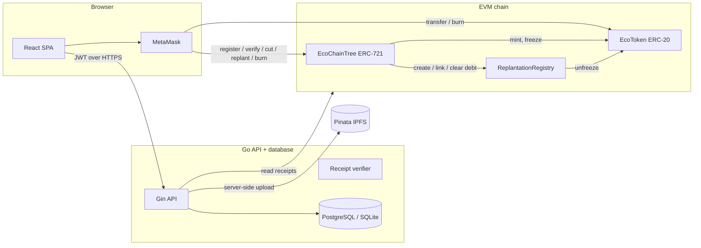

# EcoChain

EcoChain is a **testnet prototype** for tree plantation records, verifier-backed
carbon credit issuance, a credit marketplace and replantation accountability. It
connects a React app, a Go API and three Solidity contracts on an EVM chain
(Sepolia or a local Hardhat node).

It is not a certified carbon registry. Retiring an EcoToken here does not retire
a credit in any external registry, and marketplace settlement is off-chain.
[`SECURITY.md`](SECURITY.md) lists the known limitations; please read it before
treating any number in the app as a real-world offset.

## What it does

* A planter connects a wallet, registers a tree (species, GPS, photo, planting
  date) and receives an ERC-721 tree token. On-chain registration is
  permissionless; the API still requires a signed-in user, so every row is
  attributable to a wallet.
* A verifier with both the database role and the on-chain `VERIFIER_ROLE`
  verifies the tree. The verification transaction mints ERC-20 carbon credits to
  the planter in the same call.
* Credits can be listed on a marketplace (payment in native ETH to a platform
  wallet, settlement recorded in the database) or retired by burning the ERC-20.
* A cut can be reported with coordinates within 100 m of the registered tree; a
  verifier confirms it. Confirmation creates a replantation debt of
  `max(3, ceil(age/2))` trees and freezes the planter's **entire** credit
  account until every debt is cleared.
* Replacement trees must be verified and owned by the same planter. When enough
  are linked, the debt clears; the last cleared debt unfreezes the account.

## How double counting is prevented

| Risk | Control |
| --- | --- |
| One tree issued twice | One on-chain token id per database row (unique index); verification requires the `CreditsMinted` event for that token |
| One transaction reused | Unique transaction hash on credit issuance, burns and marketplace payments |
| Client invents the credit amount | The API stores the amount decoded from the `CreditsMinted` event, never the request body |
| Cut confirmed without a freeze/debt | The receipt must contain `TreeCutConfirmed` + `DebtCreated` for the same tree + `Frozen(planter)` |
| Fake burn | The API decodes `Transfer(from = wallet, to = 0x0, amount = requested)` from the configured `EcoToken` |
| Multiple credits of the same type | Unique `(tree_id, type)` index; `burned` rows are exempt |
| Frozen credits spent | Account-level freeze on the token; mints still allowed so earned credits are not lost |
| Concurrent marketplace buys | Listing row locked and re-validated inside the database transaction |
| Ledger/chain drift | `scripts/reconcile` compares balances and labels the known marketplace delta |

## Architecture



Detailed component and data-flow notes: [`docs/ARCHITECTURE.md`](docs/ARCHITECTURE.md).

## On-chain vs off-chain

| Concern | On-chain | Off-chain |
| --- | --- | --- |
| Tree identity | ERC-721 token id, planter, IPFS hash, status, carbon score | Species, nickname, precise GPS, photo URL, notes, activity feed |
| Credit ownership | `EcoToken.balanceOf`, transfer, burn, freeze, pause | Ledger mirror in `carbon_credits` for history and dashboards |
| Verification | `verifyTree` mints credits; event is the proof | Verifier decision, notes and timestamp |
| Cut state | `CUT_REPORTED` → `CUT_CONFIRMED`; account freeze | Report evidence, distance check, environmental-loss numbers |
| Replantation debt | Debt record, replacements, clearance, unfreeze | Debt mirror, certificate row, reminders |
| Roles | `AccessControl` roles on all three contracts | `users.role` for API authorization |
| Marketplace | Buyer's ETH payment is a chain transaction | **Listing, credit movement, INR price and fee are database-only** |
| Retirement | `EcoToken.burn` (Transfer to `0x0`) | Retirement row with purpose and tx hash |

### Marketplace settlement is off-chain

The buyer pays ETH to `PLATFORM_WALLET`; the backend verifies recipient, sender,
minimum amount, success and hash uniqueness, then moves credits in the database.
**No `EcoToken` transfer happens at purchase.** The buyer's on-chain balance does
not change and the seller's does not decrease. `scripts/reconcile` recognises
this exact difference and labels it `known marketplace delta (settled off-chain)`.
Until settlement is on-chain, marketplace credits and wallet tokens are not the
same claim.

## Repository layout

```
Eco-App-main/
├── Backend/api-server/      Go API (Gin, GORM), tests, scripts
├── TreeClient/              React + Vite frontend, ESLint, Vitest
├── blockchain/              Solidity contracts, Hardhat tests/scripts
├── docs/                    Architecture, gas, demo
├── .github/workflows/       CI (contracts, backend, frontend, slither)
├── SECURITY.md              Threat model and known limitations
└── README.md
```

## 10-minute quick start

Assumes Go 1.22+, Node 22+, npm and MetaMask are already installed. Works on
Windows, macOS and Linux. Commands use POSIX environment syntax; in PowerShell
set each variable first with `$env:NAME="value"`, then run the command without
the prefix.

### 1. Backend (2 min)

Create `Backend/api-server/.env` containing:

```dotenv
JWT_SECRET=replace-with-a-long-random-secret
CORS_ORIGINS=http://localhost:5173
PORT=8080
```

Then start it:

```bash
cd Backend/api-server
go run main.go
```

Leave `DB_*` unset: the server logs a Postgres warning and falls back to
`ecochain.db` (SQLite) in that directory. Expected log:
`EcoChain Backend running on http://0.0.0.0:8080`.

### 2. Frontend (2 min)

Create `TreeClient/.env` containing:

```dotenv
VITE_API_URL=http://localhost:8080
```

Then install and start:

```bash
cd TreeClient
npm install
npm run dev
```

Open `http://localhost:5173`, connect MetaMask and sign the nonce. That creates
the user row and proves the wallet-auth flow. The app can be browsed without
contracts, but any on-chain action will fail until step 3.

### 3. Local chain + contracts (4 min)

Terminal A:

```bash
cd blockchain
npx hardhat node
```

Terminal B:

```bash
cd blockchain
VERIFIER=0x70997970C51812dc3A010C7d01b50e0d17dc79C8 \
npx hardhat run scripts/deploy.js --network localhost
```

The command prints two ready-to-paste env blocks. Copy the contract addresses
into:

* `Backend/api-server/.env`: `RPC_URL=http://127.0.0.1:8545`,
  `ECO_CHAIN_TREE`, `ECO_TOKEN`, and a `PLATFORM_WALLET`.
* `TreeClient/.env`: `VITE_ECO_TOKEN`, `VITE_ECO_CHAIN_TREE`,
  `VITE_REPLANTATION_REGISTRY`, `VITE_CHAIN_ID=31337`,
  `VITE_RPC_URL=http://127.0.0.1:8545`.

Restart both processes after editing `.env`.

MetaMask: add network `http://127.0.0.1:8545`, chain id `31337`, and import the
Hardhat accounts you need (account #0 planter, #1 verifier, #2 buyer).

### 4. Promote a verifier (1 min)

The verifier needs **two** roles:

```bash
# Database role (API authorization). Run from Backend/api-server.
# Stop the backend first if you use the SQLite fallback, then restart it.
go run scripts/promote_user/main.go 0x70997970C51812dc3A010C7d01b50e0d17dc79C8 verifier

# On-chain role (transaction authorization). Run from blockchain.
CONTRACT=EcoChainTree \
CONTRACT_ADDRESS=<EcoChainTree address> \
GRANTEE=0x70997970C51812dc3A010C7d01b50e0d17dc79C8 \
ROLE=VERIFIER_ROLE \
npx hardhat run scripts/grant-role.js --network localhost
```

Log out and log in again so the JWT carries the new role.

### 5. Register → verify → cut → replant (1 min)

Follow [`docs/DEMO.md`](docs/DEMO.md) for the exact clicks and what to
screenshot. The short version: register a tree with account #0, verify it with
account #1, then report a cut at the same coordinates and confirm it. The freeze
and the 3-tree debt are visible on the debt page.

## Environment variables

### Backend (`Backend/api-server/.env`)

| Variable | Required | Default | Purpose |
| --- | --- | --- | --- |
| `JWT_SECRET` | Yes | — | Signs JWTs. Auth middleware refuses requests when unset |
| `PORT` | No | `8080` | HTTP port |
| `CORS_ORIGINS` | No | localhost:5173, localhost:3000 | Comma-separated allowed browser origins |
| `DB_HOST` | No | — | Postgres host. Leave all `DB_*` empty for SQLite fallback |
| `DB_USER` | No | — | Postgres user |
| `DB_PASSWORD` | No | — | Postgres password |
| `DB_NAME` | No | — | Postgres database |
| `DB_PORT` | No | — | Postgres port (6543 for Supabase transaction pooler) |
| `DB_SSLMODE` | No | `require` | Postgres SSL mode |
| `PINATA_JWT` | No | — | Server-side Pinata JWT; uploads fail without credentials |
| `PINATA_API_KEY` | No | — | Alternative Pinata auth |
| `PINATA_SECRET_KEY` | No | — | Alternative Pinata auth |
| `RPC_URL` | For chain features | — | Reads receipts/events; marketplace payment verification fails without it |
| `ECO_CHAIN_TREE` | For chain features | — | Expected emit of tree events; unset disables the emitter filter |
| `ECO_TOKEN` | For burns | — | Expected emit of `Transfer` burns; unset/invalid fails closed |
| `PLATFORM_WALLET` | For marketplace | — | Receives buyer payments; server refuses to settle when empty |
| `ETH_INR_RATE` | For marketplace | — | Static INR price of 1 ETH, accepted in `[1000, 100000000]` |
| `CARBON_KG_PER_CREDIT` | No | `1000` | kg CO2e per credit used by the backend formula |

### Frontend (`TreeClient/.env`)

| Variable | Required | Default | Purpose |
| --- | --- | --- | --- |
| `VITE_API_URL` | Yes for production builds | `http://localhost:8080` in dev; production build throws when unset | Backend base URL |
| `VITE_ECO_TOKEN` | For chain actions | — | `EcoToken` address |
| `VITE_ECO_CHAIN_TREE` | For chain actions | — | `EcoChainTree` address |
| `VITE_REPLANTATION_REGISTRY` | For debt links | — | Registry address |
| `VITE_CHAIN_ID` | No | `11155111` | Chain to switch to / assert (use `31337` locally) |
| `VITE_RPC_URL` | No | `https://rpc.sepolia.org` | RPC used when adding the network to MetaMask |
| `VITE_EXPLORER_URL` | No | `https://sepolia.etherscan.io` | Explorer links |

`VITE_*` values are public. Never put `PINATA_*` or `JWT_SECRET` in the frontend.

### Blockchain (`blockchain/.env`)

| Variable | Required | Purpose |
| --- | --- | --- |
| `RPC_URL` | For Sepolia | RPC endpoint used by the `sepolia` network |
| `PRIVATE_KEY` | For Sepolia | Deployer key. Testnet-only, dedicated account |
| `ADMIN` | Recommended | Receives `DEFAULT_ADMIN_ROLE` on all three contracts; a multisig is supported |
| `VERIFIER` | Recommended | Receives `VERIFIER_ROLE` on `EcoChainTree` |
| `PAUSER` | No | `PAUSER_ROLE` on `EcoToken` (defaults to `ADMIN`) |
| `FREEZER` | No | `FREEZER_ROLE` on `EcoToken` (defaults to `ADMIN`) |

The deployer grants the roles above and then revokes its own roles, so a
production deployment does not leave the hot deployer key in control.

## Deploying to Sepolia

1. Fund a dedicated testnet account with Sepolia ETH.
2. Create `blockchain/.env` from `.env.example`; set `RPC_URL`, `PRIVATE_KEY`,
   `ADMIN`, `VERIFIER`, `PAUSER`, `FREEZER`.
3. Deploy:

   ```bash
   cd blockchain
   npx hardhat run scripts/deploy.js --network sepolia
   ```

4. The script writes `blockchain/deployments/sepolia.json` (gitignored) and
   prints env blocks. Put the addresses in the backend and frontend `.env`
   files, set `VITE_CHAIN_ID=11155111`, and restart both.
5. Optional: verify the source on Etherscan (commands in
   [`blockchain/deployments/README.md`](blockchain/deployments/README.md)).

### Roles and verifier promotion

| Role | Contract | Who should hold it |
| --- | --- | --- |
| `DEFAULT_ADMIN_ROLE` | all three | The operator's multisig / admin address |
| `VERIFIER_ROLE` | `EcoChainTree` | The verification service or human verifier |
| `MINTER_ROLE` | `EcoToken` | **Only** the `EcoChainTree` contract |
| `PAUSER_ROLE` | `EcoToken` | Incident-response key |
| `FREEZER_ROLE` | `EcoToken` | `EcoChainTree`, `ReplantationRegistry`, optional human freezer |

**Why the database role must match the on-chain role.** The API checks
`users.role` before accepting a verification request; the contract checks
`VERIFIER_ROLE` before executing `verifyTree`/`confirmCut`/`markReplanted`. One
without the other fails:

* DB role only → the API calls the wallet, the transaction reverts, the tree is
  not verified.
* On-chain role only → the API returns `403` before the wallet is asked.

Grant both, then re-login so the JWT reflects the new database role:

```bash
# 1. Database
cd Backend/api-server
go run scripts/promote_user/main.go 0xYOUR_VERIFIER verifier

# 2. Chain (signer must hold DEFAULT_ADMIN_ROLE)
cd blockchain
CONTRACT=EcoChainTree CONTRACT_ADDRESS=0x... GRANTEE=0xYOUR_VERIFIER \
  ROLE=VERIFIER_ROLE npx hardhat run scripts/grant-role.js --network sepolia
```

The contract has no owner-controlled bypass: the only way to get credits minted
is `verifyTree`, and the only way to clear a debt is for the tree contract to
observe enough linked replacements.

## Credit model

One credit is one tonne of CO2e (`CARBON_KG_PER_CREDIT`, default 1000 kg):

```text
age    = max(now - plantedAt, 0.1 years)
rate   = carbonScorePerYear (kg CO2/yr)
credit = round(rate × age / 1000, 4)
amount = credit × 1e18
```

The Go backend (`services.CreditsForTree`) and the contract
(`EcoChainTree.creditsForTree`) implement the same formula. The backend stores
the amount from the `CreditsMinted` event; `blockchain/scripts/verify-credit-formula.js`
and the test suites cross-check the implementations.

## Tests and CI

Run locally:

```bash
# Contracts (85 tests, includes 3 seeded invariant tests)
cd blockchain && npx hardhat test

# Backend (coverage gate is 65% total)
cd Backend/api-server && go vet ./... && go test ./... -cover

# Frontend
cd TreeClient && npm run lint && npm test && npm run build
```

CI (`.github/workflows/ci.yml`) runs four jobs on pushes and PRs:

1. **Contracts** — compile, `npx hardhat test` with `REPORT_GAS=true` (gas table
   in the log and `gas-report.txt` artifact), `npx hardhat coverage`.
2. **Backend** — `go vet`, tests with a 65% total coverage gate, per-package
   coverage summary, and `go test -race` (race runs in CI only because it needs
   a C toolchain).
3. **Frontend** — ESLint, Vitest, production build.
4. **Slither** — non-blocking report, uploaded as an artifact.

`golangci-lint` is not installed in this repository; `go vet` is the blocking Go
lint gate. Gas numbers are in [`docs/GAS.md`](docs/GAS.md).

## Integrity tooling

**Local on-chain end-to-end proof** (permissionless registration → verifier mint
→ cut → freeze → 3 replacements → unfreeze), using the same `deployCore` role
wiring as production:

```bash
cd blockchain
npx hardhat node                                        # terminal 1
npx hardhat run scripts/e2e-local.js --network localhost # terminal 2
```

**Balance reconciliation** (on-chain `EcoToken.balanceOf` vs off-chain ledger
`earned - burned`), with the marketplace delta labelled explicitly:

```bash
cd Backend/api-server
RPC_URL=https://... ECO_TOKEN=0x... go run scripts/reconcile/main.go
```

**Server-side receipt verification.** `services/chain_verifier.go` decodes
`CreditsMinted`, `TreeCutConfirmed` (+ `DebtCreated` + `Frozen`) and
`TreeReplanted` from the receipt, and `Transfer(to = 0x0)` for burns. The
controllers refuse off-chain state changes that the chain does not back.

## Documentation

* [`docs/ARCHITECTURE.md`](docs/ARCHITECTURE.md) — components, authority, data flow, invariants
* [`SECURITY.md`](SECURITY.md) — threat model, abuse cases, residual risk, limitations
* [`docs/DEMO.md`](docs/DEMO.md) — exact demo steps and screenshots
* [`docs/GAS.md`](docs/GAS.md) — gas table and how to reproduce it

## Known limitations

* Single verifier trust: one key can verify arbitrary trees and choose the
  absorption rate and planting date. No quorum, no challenge window.
* Static `ETH_INR_RATE`: marketplace pricing does not follow the market.
* Self-declared GPS: the 100 m cut-report check is not proof of location.
* Marketplace settlement is off-chain; token balances do not move on purchase.
* Tree metadata and evidence live off-chain (database + IPFS).
* Testnet only; no audit; not a legal carbon offset instrument.

These are described in full, with residual risk, in [`SECURITY.md`](SECURITY.md).
