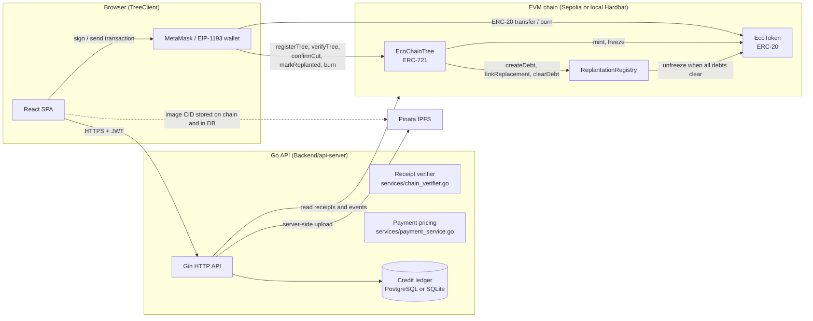
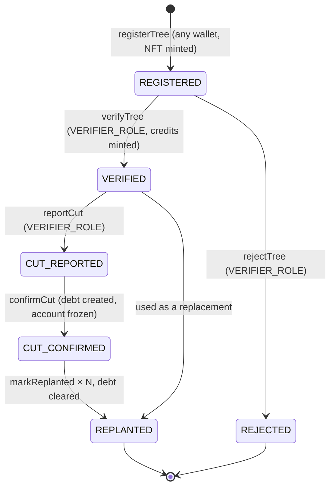

# Architecture

EcoChain is a testnet prototype for tree registration, verifier-backed carbon
credit issuance, marketplace trading and replantation accountability. This
document describes what runs where, which state is authoritative, and where the
trust boundaries are. It deliberately describes the system as implemented, not
as it might eventually be.

## 1. System context



The browser talks to the API with a JWT obtained from a wallet-signature login.
It also talks to the chain directly through the user's wallet: the backend never
holds a user's key for normal user actions. The API reads the chain (public RPC)
to verify that a state change it is about to record is actually backed by a
successful transaction.

## 2. Components

| Component | Location | Responsibility |
| --- | --- | --- |
| React SPA | `TreeClient/` | Wallet login, tree registration, verification queue, marketplace, cut reporting, debt dashboard, credit retirement |
| Go API | `Backend/api-server/` | Authentication, authorization, off-chain ledger, marketplace settlement, chain receipt verification, IPFS proxy |
| PostgreSQL / SQLite | `Backend/api-server/config/db.go` | Off-chain system of record: users, trees metadata, credits ledger, listings, transactions, debt mirrors, activity log |
| `EcoToken` | `blockchain/contracts/EcoToken.sol` | ERC-20 carbon credit, 1 token = 1 credit = 1000 kg CO2e; mint/burn/transfer; account freeze; global pause |
| `EcoChainTree` | `blockchain/contracts/EcoChainTree.sol` | ERC-721 tree identity and lifecycle state; verification mints credits; cut confirmation creates debt and freezes the planter; replacement linking clears debt |
| `ReplantationRegistry` | `blockchain/contracts/ReplantationRegistry.sol` | Debt records and replacement links; only callable by `EcoChainTree`; lifts the token freeze when the last open debt is cleared |
| Hardhat scripts | `blockchain/scripts/` | Deployment, role wiring, local end-to-end proof, role grants, formula cross-check |
| Pinata | external | Stores tree photos and metadata; the backend proxies uploads so credentials never reach the browser |
| RPC endpoint | external | Reads receipts/events for verification; also used by the reconcile script |

## 3. What is authoritative

There are two stores, and they answer different questions.

* **The chain is authoritative for credit ownership and lifecycle finality.**
  `EcoToken.balanceOf` is the real balance of a wallet. `EcoChainTree.trees`
  is the real tree status. `ReplantationRegistry.debts` is the real debt state.
  A tree cut confirmation and the resulting freeze/debt are only accepted by the
  API when the transaction actually emitted the expected events.
* **The database is authoritative for the user-facing catalogue and the
  marketplace.** Species, photos, GPS, names, verifier notes, activity feeds,
  listing prices and marketplace transactions live only in the database. The
  database also mirrors credits in a ledger (`carbon_credits`) so pages can show
  history without scanning the chain.

The API is the bridge: every off-chain state change that has an on-chain
consequence first verifies the on-chain evidence, then writes the database. The
reverse is not automatic — the database does not apply chain events it was not
told about, which is why `scripts/reconcile` exists.

### Uniqueness invariants

| Invariant | Where enforced |
| --- | --- |
| One tree row per on-chain token id | `trees.blockchain_token_id` partial unique index |
| One issuance per on-chain transaction | `carbon_credits.transaction_hash` partial unique index |
| One minted/penalty row per tree and type | `carbon_credits (tree_id, type)` partial unique index (`burned` rows exempt) |
| One payment per transaction hash | `marketplace_transactions.tx_hash` unique index |
| One tree per IPFS hash | `EcoChainTree.ipfsHashUsed` |
| One debt per cut tree | `ReplantationRegistry.debtIdForOriginalToken` |
| A replacement cannot be linked twice | `ReplantationRegistry.tokenToDebt` |
| Debt cannot clear below its replacement count | `replacementsFulfilled >= replacementsNeeded` |

## 4. Tree lifecycle



The database mirrors these states for display (`PENDING_VERIFICATION`,
`VERIFIED`, `CUT_REPORTED`, `CUT_CONFIRMED`, `REPLANTED`, `REJECTED`), but the
chain is the source of truth for status. A tree can be registered in the
database without an on-chain token if the registration transaction failed; such
a tree cannot be verified because the verifier's transaction would revert.

### Credit accounting

One credit is one tonne of CO2e (1000 kg by default, configurable with
`CARBON_KG_PER_CREDIT` on the backend; the contract constant is fixed at 1000).

```text
rate  = carbonScorePerYear / 100          # kg CO2 per year
age   = max(now - plantedAt, 0.1 years)   # floor avoids zero-credit trees
kg    = rate × age
credit = round(kg / 1000 × 10000) / 10000 # 4 decimal places
amount = credit × 1e18                     # ERC-20 amount
```

The same formula exists twice on purpose:

* `Backend/api-server/services/carbon_service.go` — `CreditsForTree`
* `blockchain/contracts/EcoChainTree.sol` — `creditsForTree`

The backend stores the amount decoded from the `CreditsMinted` event, never the
amount the client claims. `blockchain/scripts/verify-credit-formula.js` and the
Go tests cross-check the two implementations.

### Cut and replantation

1. A tree owner (or verifier) reports a cut with GPS coordinates. The API
   rejects the report unless the reporter is within 100 m of the registered
   coordinates and freezes that tree's off-chain credits/listings.
2. A verifier confirms the cut. The API requires one successful transaction
   containing `TreeCutConfirmed`, a matching `DebtCreated` for the same tree, and
   `Frozen(planter)`. The database then marks the tree cut, records the
   environmental loss (CO2 kg and O2 kg using a 0.727 mass ratio), and creates
   the debt mirror.
3. `replacementsNeeded = max(3, ceil(ageYears / 2))`. The contract enforces the
   floor of 3; the age is passed in by the verifier because age is not stored
   on-chain.
4. Each replacement must be a verified tree registered by the same planter. It
   is linked to the debt; the cut tree and the replacement become `REPLANTED`.
5. When `replacementsFulfilled >= replacementsNeeded`, the registry clears the
   debt. If that was the wallet's last open debt, the registry unfreezes the
   account.

The freeze is account-level, not per-tree: a planter with one open debt cannot
move, sell or burn any credit until every debt is cleared. New credits can still
be minted to a frozen account, so earned credits are not destroyed.

## 5. Verification gates

The API refuses to record these changes unless the chain backs them. The
decoders are package-level seams so tests can feed deterministic receipts; in
production they always read a real receipt.

| API action | Required on-chain evidence |
| --- | --- |
| `POST /api/trees/:id/verify` | successful tx with `CreditsMinted(tokenId = tree's token, planter = tree owner)`; stored amount comes from the event |
| `POST /api/trees/:id/cut/confirm` | same tx contains `TreeCutConfirmed(tokenId)`, `DebtCreated(originalTokenId = tokenId, debtor = planter)` and `Frozen(planter)` |
| `POST /api/debt/:id/link-tree` | `TreeReplanted(replacementTokenId, originalTokenId)`; replacement and debt rows must match |
| `POST /api/credits/burn` | `EcoToken` `Transfer(from = authenticated wallet, to = 0x0, amount = requested amount)` when `RPC_URL` is set |
| `POST /api/marketplace/buy` | native ETH payment to `PLATFORM_WALLET`, from the buyer wallet, value ≥ server-computed minimum, successful status; tx hash unique |

`ECO_CHAIN_TREE` and `ECO_TOKEN` configure which contract addresses count as the
expected emitters. If `ECO_TOKEN` is unset or invalid, burn verification fails
closed rather than accepting an unverified hash. If `ECO_CHAIN_TREE` is unset the
tree decoders accept a matching event from any contract, so configure it on any
shared deployment.

## 6. Marketplace settlement (off-chain)

The marketplace is intentionally **custodial with respect to credit ownership**:

1. The seller lists credits. The API decrements the tree's available credits and
   creates an `ACTIVE` listing.
2. The buyer sends native ETH to the platform wallet in a wallet transaction.
3. The API verifies the payment transaction hash (recipient, sender, minimum
   amount from `ETH_INR_RATE`, success, uniqueness) and, in one database
   transaction, decrements the listing, credits the buyer's ledger, credits the
   seller's INR proceeds and records a `CONFIRMED` transaction.
4. **No `EcoToken` transfer happens.** The buyer's on-chain token balance does
   not change at purchase time.

This is the largest known accounting delta in the system. `scripts/reconcile`
labels it and only reports a true mismatch when the difference is not explained
by marketplace settlement. Moving settlement on-chain would require an escrow or
atomic swap design and is out of scope for this prototype.

## 7. Authentication and authorization

* Login is EIP-191 personal-sign over `EcoChain Auth Nonce: <nonce>`. Nonces are
  single-use and expire; the JWT carries the user id and role.
* The database role (`user`, `verifier`, `admin`) gates API endpoints.
* The on-chain role (`VERIFIER_ROLE`) gates transactions. **Both are required
  for verifier actions.** Granting only the database role produces a 403 from
  the contract; granting only the on-chain role produces a 403 from the API.
* Contract roles are managed with OpenZeppelin `AccessControl`:
  * `EcoToken`: `DEFAULT_ADMIN_ROLE`, `MINTER_ROLE` (only `EcoChainTree`),
    `PAUSER_ROLE`, `FREEZER_ROLE` (`EcoChainTree`, `ReplantationRegistry`,
    optional human freezer).
  * `EcoChainTree`: `DEFAULT_ADMIN_ROLE`, `VERIFIER_ROLE`.
  * `ReplantationRegistry`: `DEFAULT_ADMIN_ROLE` only. No role can create,
    link or clear debts; only the `EcoChainTree` contract can, and it validates
    tree state first.

`scripts/deployCore.js` is the single source of truth for role wiring and is
used by both deployment and the test fixture, so tests exercise the same role
layout that is deployed. The deployer hands roles to `ADMIN`, `VERIFIER`,
`PAUSER`, `FREEZER` and then revokes its own roles.

## 8. Failure modes and deliberate limits

| Failure | Behaviour |
| --- | --- |
| RPC unavailable | Verification endpoints fail with an error; they never accept an unverifiable transaction |
| `RPC_URL` unset | Burn hashes are recorded unverified (documented); tree/cut/debt verification still requires a decodable transaction and fails without RPC |
| Replayed transaction hash | Unique index rejects the second write (409) |
| Concurrent marketplace buys | Listing row is locked and re-validated inside the transaction |
| Verifier signs a cut for the wrong planter | Decoder requires `Frozen(planter)` where planter matches the tree owner; otherwise the API rejects |
| Duplicate tree registration | On-chain `ipfsHashUsed` and DB unique token id |
| Marketplace purchase | Off-chain credit movement only (known delta, see §6) |
| Backend key compromise | There is no backend key for user transactions; the backend's blockchain service is only used where a signer is explicitly configured (`services/blockchain_service.go`) |

The threat model and residual risks are in [`../SECURITY.md`](../SECURITY.md).
